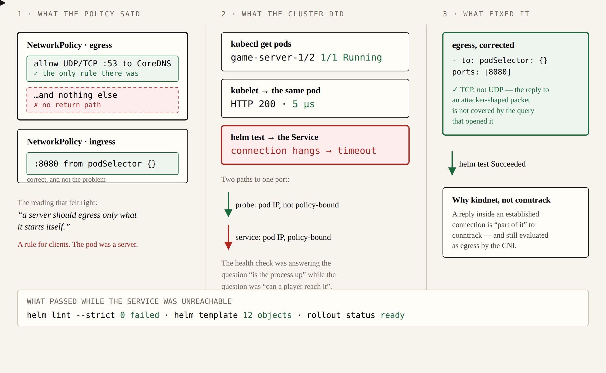

# k8s-game-server-charts

A Helm chart for a game server on Kubernetes, and the two things a game server needs that a web API does
not: a rollout that does not disconnect the matches in progress, and probes that tell a database blip
apart from a dead pod.

```bash
make verify     # creates a kind cluster, installs the chart, checks the service answers, tears nothing down
```

**Verified on a real cluster, not asserted**: 2 pods `1/1 Running`, `helm test` `Succeeded`, HPA and PDB
created, `helm get values` never holds a secret.

## What is in the chart

| Object | Why |
|---|---|
| Deployment | `maxUnavailable: 0` + `maxSurge: 1` (a pod hosts matches), `terminationGracePeriodSeconds: 30` (the drain budget), `readOnlyRootFilesystem`, non-root, all capabilities dropped |
| Probes | startup (waiting for a migration), readiness `httpGet` (may touch the database), **liveness `tcpSocket`** - a liveness probe that queries the database restarts every pod during a database blip and turns a bad minute into an outage |
| Service | ClusterIP, port 8080 |
| HorizontalPodAutoscaler | 2 → 10 on 70% CPU, scale up fast and down over five minutes, because players arrive faster than they leave |
| PodDisruptionBudget | `minAvailable: 1`: without it a node drain evicts every replica it holds at once |
| NetworkPolicy | ingress from the namespace's pods on the service port, egress for DNS and for the answers - see the incident below |
| ServiceAccount | `automountServiceAccountToken: false`: a server that does not call the API server should not hold a token for it |
| Secret | **not in the chart** - see below |

## The chart refuses to hold a secret

`templates/secret.yaml` renders no value at all. It either finds the Secret the deployment references or
it fails the render:

```
$ helm template dev charts/game-server
Error: execution error at (game-server/templates/secret.yaml):
secret.existingSecret is empty: name the Secret that holds the database password and the server key
(an ExternalSecret is the usual way), rather than putting them in values.yaml
```

A chart that can hold a secret is a chart that leaks one: it ends up in a values file in a repository, or
in a release history that anyone with `get secrets` can read. `make guard` asserts that this failure still
happens, because a guard nobody tests is a guard that quietly stops working.

The pattern this leaves room for is External Secrets: an `ExternalSecret` syncs the value from the
vault into the Secret the chart names, and the chart never learns what is in it.

## An incident this chart caused, and what fixed it

`helm test` failed with `wget: download timed out` while the kubelet's probes answered 200. The
NetworkPolicy was the cause, and the interesting part is which rule: ingress allowed the connection, and
the **egress** rule that only allowed DNS dropped the *response*, because the CNI evaluates egress
packets without tracking which inbound connection they belong to. The fix is one egress rule back to the
pods that may connect - written up in [`docs/incidents/`](docs/incidents/networkpolicy-blocked-its-own-service.md),
because the next person to see "the service answers the kubelet and nobody else" should recognise it.

## What this is not

Not a chart for a stateful game backend (a database per instance needs an operator), and not a
replacement for capacity planning: the HPA scales on CPU, which is the metric that is available, not the
one that is right - the right one is players per pod.

## Repository standard

Six items, applied where they mean something rather than everywhere. The exclusions are the point of
the table: an item that cannot be honest in a repository of this kind is left out and said so.

| Item | Here |
|---|---|
| `docker-compose.yml` | not applicable - the deliverable is the chart, there is no application image here |
| `Dockerfile` | not applicable - same reason: nothing is built, the chart is rendered |
| Helm chart | ✓ `charts/game-server/` |
| Diagram | ✓ `docs/figures/networkpolicy-egress-incident.html` plus the exported PNG the README embeds |
| Tests, run in CI | ✓ Lint the chart strictly, The chart must refuse to render without a secret, Render and check the claims, Install it on a cluster and ask the service |
| CI + `Makefile` | ✓ `.github/workflows/ci.yml` and `Makefile` |

## License

MIT. See `LICENSE`, and `PROVENANCE.md` for where this comes from.

## The incident as a picture



**Figure 1.** The response packets were the egress — a NetworkPolicy incident

`docs/figures/networkpolicy-egress-incident.html` is a self-contained explanation of the fault this chart
shipped with: a policy that allowed ingress and only DNS outwards, and a service that answered the kubelet
in five microseconds while refusing every client. It is HTML with inline SVG rather than a PNG for the same
reason the chart is YAML — the source is reviewable and diffable, and the image is a build artifact:

```bash
make diagram   # exports a PNG using a local chromium, if there is one
```

The figure is embedded above as a PNG; `docs/figures/networkpolicy-egress-incident.html` is the source it
is exported from.

**The rule it is drawn to explain:** a pod that serves traffic has to allow the traffic back out. "Egress
only what it starts itself" describes a client; for a server, the response *is* egress of that pod.
